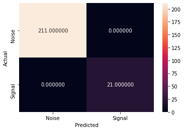
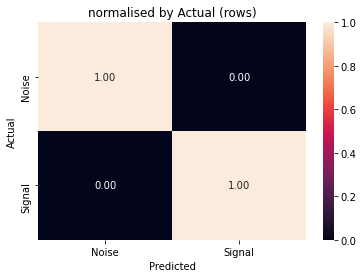

```python
import glob
import pandas as pd
import numpy as np
import matplotlib.pyplot as plt
import seaborn as sns
from pyfix import io, classify
from sklearn import svm, ensemble, neighbors, tree, neural_network as nn, metrics
```

# Download example data


```python
datadir = '/Users/seanf/scratch/testing-pyfix/example_data'
```

# Train (group)

Train FIX on a group of labelled subjects.

Generate a table of files.  The table must minimally have a column of `feature` filenames and a column of `label` filenames.  Other columns are allowed and can be used for grouping data.  For example, here I add a column of `subids` that will be used for leave-one-subject-out training.


```python
# from pyfix import legacy, io, classify

features = glob.glob(f'{datadir}/HCP25_hp2000/*/MNINonLinear/Results/rfMRI_REST*/rfMRI_REST*_hp2000.ica/fix/features.pyfix_features')
labels = glob.glob(f'{datadir}/HCP25_hp2000/*/MNINonLinear/Results/rfMRI_REST*/rfMRI_REST*_hp2000.ica/hand_labels_noise.txt')
subid = [f.split('/')[7] for f in labels]

file_table = pd.DataFrame({
    'subid': subid,
    'features': features,
    'labels': labels,
})

file_table.head(10)

```


<div>
<style scoped>
    .dataframe tbody tr th:only-of-type {
        vertical-align: middle;
    }

    .dataframe tbody tr th {
        vertical-align: top;
    }

    .dataframe thead th {
        text-align: right;
    }
</style>
<table border="1" class="dataframe">
  <thead>
    <tr style="text-align: right;">
      <th></th>
      <th>subid</th>
      <th>features</th>
      <th>labels</th>
    </tr>
  </thead>
  <tbody>
    <tr>
      <th>0</th>
      <td>792564</td>
      <td>/Users/seanf/scratch/testing-pyfix/example_dat...</td>
      <td>/Users/seanf/scratch/testing-pyfix/example_dat...</td>
    </tr>
    <tr>
      <th>1</th>
      <td>792564</td>
      <td>/Users/seanf/scratch/testing-pyfix/example_dat...</td>
      <td>/Users/seanf/scratch/testing-pyfix/example_dat...</td>
    </tr>
    <tr>
      <th>2</th>
      <td>792564</td>
      <td>/Users/seanf/scratch/testing-pyfix/example_dat...</td>
      <td>/Users/seanf/scratch/testing-pyfix/example_dat...</td>
    </tr>
    <tr>
      <th>3</th>
      <td>792564</td>
      <td>/Users/seanf/scratch/testing-pyfix/example_dat...</td>
      <td>/Users/seanf/scratch/testing-pyfix/example_dat...</td>
    </tr>
    <tr>
      <th>4</th>
      <td>856766</td>
      <td>/Users/seanf/scratch/testing-pyfix/example_dat...</td>
      <td>/Users/seanf/scratch/testing-pyfix/example_dat...</td>
    </tr>
    <tr>
      <th>5</th>
      <td>856766</td>
      <td>/Users/seanf/scratch/testing-pyfix/example_dat...</td>
      <td>/Users/seanf/scratch/testing-pyfix/example_dat...</td>
    </tr>
    <tr>
      <th>6</th>
      <td>856766</td>
      <td>/Users/seanf/scratch/testing-pyfix/example_dat...</td>
      <td>/Users/seanf/scratch/testing-pyfix/example_dat...</td>
    </tr>
    <tr>
      <th>7</th>
      <td>856766</td>
      <td>/Users/seanf/scratch/testing-pyfix/example_dat...</td>
      <td>/Users/seanf/scratch/testing-pyfix/example_dat...</td>
    </tr>
    <tr>
      <th>8</th>
      <td>499566</td>
      <td>/Users/seanf/scratch/testing-pyfix/example_dat...</td>
      <td>/Users/seanf/scratch/testing-pyfix/example_dat...</td>
    </tr>
    <tr>
      <th>9</th>
      <td>499566</td>
      <td>/Users/seanf/scratch/testing-pyfix/example_dat...</td>
      <td>/Users/seanf/scratch/testing-pyfix/example_dat...</td>
    </tr>
  </tbody>
</table>
</div>


Optionally save/load the `file_table` for reuse:


```python
# save
io.save_file_table(f'{datadir}/HCP25_hp2000/hcp', file_table)

# load
io.read_file_table(f'{datadir}/HCP25_hp2000/hcp.file_table');
```

Generate a `feature_table` that collates all the features from the files specified in the `file_table`.  Note, that we specify `group_by='subid'` which will add a `group` column to the table based on the `subid`.  This will be used for leave-one-subject-out training.


```python
training_data = classify.collate_features(file_table, legacy_features=False, group_by='subid')
training_data.head()
```


<div>
<style scoped>
    .dataframe tbody tr th:only-of-type {
        vertical-align: middle;
    }

    .dataframe tbody tr th {
        vertical-align: top;
    }

    .dataframe thead th {
        text-align: right;
    }
</style>
<table border="1" class="dataframe">
  <thead>
    <tr style="text-align: right;">
      <th></th>
      <th>arfull:0</th>
      <th>arfull:1</th>
      <th>arfull:2</th>
      <th>arfull:3</th>
      <th>arfull:4</th>
      <th>arvswgn:0</th>
      <th>arvswgn:1</th>
      <th>clusterdist:0</th>
      <th>clusterdist:1</th>
      <th>clusterdist:2</th>
      <th>...</th>
      <th>tsjump:2</th>
      <th>tsjump:3</th>
      <th>tsjump:4</th>
      <th>tsjump:5</th>
      <th>zstattofuncratio:0</th>
      <th>zstattofuncratio:1</th>
      <th>zstattofuncratio:2</th>
      <th>zstattofuncratio:3</th>
      <th>group</th>
      <th>label</th>
    </tr>
  </thead>
  <tbody>
    <tr>
      <th>0</th>
      <td>0.020465</td>
      <td>-0.989706</td>
      <td>0.019260</td>
      <td>-1.229937</td>
      <td>0.242730</td>
      <td>-0.000774</td>
      <td>0.020092</td>
      <td>164.0</td>
      <td>102.146341</td>
      <td>15741.0</td>
      <td>...</td>
      <td>0.020506</td>
      <td>12.765491</td>
      <td>0.010682</td>
      <td>0.989747</td>
      <td>6178.921172</td>
      <td>4288.312109</td>
      <td>0.000157</td>
      <td>0.000060</td>
      <td>792564</td>
      <td>False</td>
    </tr>
    <tr>
      <th>1</th>
      <td>0.006556</td>
      <td>-0.996714</td>
      <td>0.006555</td>
      <td>-0.986911</td>
      <td>-0.009836</td>
      <td>-0.000074</td>
      <td>0.006595</td>
      <td>201.0</td>
      <td>53.253731</td>
      <td>8428.0</td>
      <td>...</td>
      <td>0.005588</td>
      <td>7.845732</td>
      <td>0.006565</td>
      <td>0.997205</td>
      <td>7134.435879</td>
      <td>5338.732422</td>
      <td>0.000136</td>
      <td>0.000062</td>
      <td>792564</td>
      <td>False</td>
    </tr>
    <tr>
      <th>2</th>
      <td>0.033442</td>
      <td>-0.983123</td>
      <td>0.033368</td>
      <td>-1.029407</td>
      <td>0.047078</td>
      <td>-0.000963</td>
      <td>0.033760</td>
      <td>255.0</td>
      <td>39.184314</td>
      <td>7687.0</td>
      <td>...</td>
      <td>0.032089</td>
      <td>12.410799</td>
      <td>0.010386</td>
      <td>0.983942</td>
      <td>7687.846562</td>
      <td>4976.416309</td>
      <td>0.000152</td>
      <td>0.000065</td>
      <td>792564</td>
      <td>False</td>
    </tr>
    <tr>
      <th>3</th>
      <td>0.033725</td>
      <td>-0.982979</td>
      <td>0.033511</td>
      <td>-1.061286</td>
      <td>0.079663</td>
      <td>-0.002705</td>
      <td>0.033484</td>
      <td>117.0</td>
      <td>165.529915</td>
      <td>18506.0</td>
      <td>...</td>
      <td>0.033392</td>
      <td>11.661642</td>
      <td>0.009759</td>
      <td>0.983299</td>
      <td>4069.844775</td>
      <td>2779.257910</td>
      <td>0.000108</td>
      <td>0.000043</td>
      <td>792564</td>
      <td>False</td>
    </tr>
    <tr>
      <th>4</th>
      <td>0.028581</td>
      <td>-0.985594</td>
      <td>0.028456</td>
      <td>-1.050688</td>
      <td>0.066046</td>
      <td>-0.001393</td>
      <td>0.028598</td>
      <td>168.0</td>
      <td>69.261905</td>
      <td>10388.0</td>
      <td>...</td>
      <td>0.025580</td>
      <td>8.785997</td>
      <td>0.007352</td>
      <td>0.987191</td>
      <td>3419.136094</td>
      <td>2421.804102</td>
      <td>0.000074</td>
      <td>0.000030</td>
      <td>792564</td>
      <td>False</td>
    </tr>
  </tbody>
</table>
<p>5 rows × 188 columns</p>
</div>


Create a classifier `RandomForest` in this example) and train with leave-out-out evaluation.  Any classifier from [scikit-learn](https://scikit-learn.org/stable/) that generates a probablistic output can be used.


```python
clf = ensemble.RandomForestClassifier(n_estimators=50)
# clf = nn.MLPClassifier(solver='lbfgs', early_stopping=True)
# clf = ensemble.GradientBoostingClassifier()
# clf = svm.SVC(probability=True, C=1, gamma='scale', class_weight="balanced")

clf, y = classify.train(training_data, clf, loo=True)
```

Save trained model.


```python
io.save_model(f'{datadir}/HCP25_hp2000/hcp', clf)

! ls {datadir}/HCP25_hp2000/hcp.pyfix_model
```

    /Users/seanf/scratch/testing-pyfix/example_data/HCP25_hp2000/hcp.pyfix_model


Report LOO classification results as per `legacy FIX`.


```python
from pyfix import legacy
print(legacy.report_loo(y['actual'], y['predicted_pb'], y['idx']))
```

                    TPR                                                                             TNR                                                                       (3*TPR+TNR)/4                                                                      
    Threshold      1.0       2.0       5.0       10.0      20.0      30.0      40.0      50.0      1.0       2.0       5.0       10.0      20.0      30.0      40.0      50.0          1.0       2.0       5.0       10.0      20.0      30.0      40.0      50.0
    Fold                                                                                                                                                                                                                                                         
    0          1.000000  1.000000  1.000000  1.000000  1.000000  1.000000  1.000000  1.000000  0.910793  0.957048  0.970264  0.985683  0.993392  0.993392  0.995595  0.995595      0.977698  0.989262  0.992566  0.996421  0.998348  0.998348  0.998899  0.998899
    1          1.000000  1.000000  1.000000  1.000000  0.991150  0.982301  0.973451  0.964602  0.883028  0.948394  0.964450  0.974771  0.981651  0.983945  0.987385  0.989679      0.970757  0.987099  0.991112  0.993693  0.988776  0.982712  0.976935  0.970871
    2          1.000000  1.000000  1.000000  1.000000  1.000000  0.981818  0.963636  0.945455  0.867600  0.950484  0.975242  0.993541  0.997847  0.998924  0.998924  0.998924      0.966900  0.987621  0.993811  0.998385  0.999462  0.986095  0.972458  0.958822
    3          1.000000  1.000000  1.000000  1.000000  1.000000  0.990991  0.981982  0.972973  0.863122  0.924208  0.952489  0.975113  0.985294  0.992081  0.997738  1.000000      0.965781  0.981052  0.988122  0.993778  0.996324  0.991264  0.985921  0.979730
    4          1.000000  1.000000  1.000000  1.000000  1.000000  1.000000  0.973333  0.960000  0.728649  0.872432  0.930811  0.980541  0.993514  0.996757  0.997838  0.997838      0.932162  0.968108  0.982703  0.995135  0.998378  0.999189  0.979459  0.969459
    5          1.000000  1.000000  1.000000  1.000000  0.987952  0.987952  0.987952  0.987952  0.801869  0.908411  0.943925  0.977570  0.988785  0.992523  0.994393  0.998131      0.950467  0.977103  0.985981  0.994393  0.988160  0.989095  0.989562  0.990497
    6          1.000000  1.000000  1.000000  1.000000  1.000000  1.000000  1.000000  1.000000  0.864899  0.949495  0.970960  0.989899  0.993687  0.996212  0.996212  0.997475      0.966225  0.987374  0.992740  0.997475  0.998422  0.999053  0.999053  0.999369
    7          1.000000  1.000000  1.000000  1.000000  0.984848  0.984848  0.954545  0.954545  0.881137  0.961240  0.979328  0.992248  0.998708  1.000000  1.000000  1.000000      0.970284  0.990310  0.994832  0.998062  0.988313  0.988636  0.965909  0.965909
    8          0.991304  0.991304  0.991304  0.991304  0.982609  0.973913  0.973913  0.965217  0.923777  0.964733  0.971559  0.985210  0.996587  0.998862  0.998862  0.998862      0.974423  0.984661  0.986368  0.989781  0.986103  0.980150  0.980150  0.973629
    9          1.000000  1.000000  1.000000  1.000000  1.000000  1.000000  1.000000  0.987654  0.801959  0.911861  0.958651  0.981502  0.988030  0.991295  0.993471  0.997824      0.950490  0.977965  0.989663  0.995375  0.997008  0.997824  0.998368  0.990197
    10         1.000000  1.000000  1.000000  1.000000  1.000000  1.000000  1.000000  0.989583  0.896089  0.949721  0.973184  0.989944  0.996648  0.996648  0.997765  0.998883      0.974022  0.987430  0.993296  0.997486  0.999162  0.999162  0.999441  0.991908
    11         1.000000  1.000000  1.000000  0.992188  0.984375  0.976562  0.945312  0.937500  0.856651  0.925459  0.947248  0.972477  0.989679  0.993119  0.995413  0.996560      0.964163  0.981365  0.986812  0.987260  0.985701  0.980702  0.957838  0.952265
    12         1.000000  1.000000  1.000000  1.000000  1.000000  1.000000  1.000000  0.972603  0.862999  0.938511  0.962244  0.985976  0.992449  0.996764  0.998921  1.000000      0.965750  0.984628  0.990561  0.996494  0.998112  0.999191  0.999730  0.979452
    13         1.000000  1.000000  1.000000  1.000000  1.000000  1.000000  1.000000  1.000000  0.886161  0.946429  0.959821  0.967634  0.979911  0.983259  0.987723  0.991071      0.971540  0.986607  0.989955  0.991908  0.994978  0.995815  0.996931  0.997768
    14         1.000000  1.000000  1.000000  1.000000  0.981481  0.962963  0.944444  0.935185  0.887514  0.961755  0.979753  0.992126  0.997750  0.998875  1.000000  1.000000      0.971879  0.990439  0.994938  0.998031  0.985549  0.971941  0.958333  0.951389
    15         1.000000  1.000000  1.000000  0.988636  0.988636  0.954545  0.920455  0.909091  0.898286  0.961143  0.970286  0.982857  0.992000  0.993143  0.997714  1.000000      0.974571  0.990286  0.992571  0.987192  0.989477  0.964195  0.939769  0.931818
    16         1.000000  1.000000  1.000000  1.000000  1.000000  1.000000  1.000000  0.976190  0.849741  0.924007  0.949914  0.975820  0.982729  0.987910  0.989637  0.994819      0.962435  0.981002  0.987478  0.993955  0.995682  0.996978  0.997409  0.980848
    17         1.000000  0.993421  0.993421  0.993421  0.980263  0.980263  0.980263  0.967105  0.887942  0.951279  0.964677  0.980512  0.989038  0.992692  0.997564  0.997564      0.971985  0.982886  0.986235  0.990194  0.982457  0.983370  0.984588  0.974720
    18         1.000000  1.000000  1.000000  0.991667  0.983333  0.975000  0.958333  0.950000  0.912442  0.966590  0.979263  0.988479  0.993088  1.000000  1.000000  1.000000      0.978111  0.991647  0.994816  0.990870  0.985772  0.981250  0.968750  0.962500
    19         1.000000  1.000000  1.000000  1.000000  1.000000  1.000000  0.975610  0.975610  0.877088  0.951074  0.973747  0.986874  0.995227  0.997613  1.000000  1.000000      0.969272  0.987768  0.993437  0.996718  0.998807  0.999403  0.981707  0.981707
    20         1.000000  1.000000  0.989362  0.989362  0.989362  0.978723  0.957447  0.957447  0.873576  0.938497  0.955581  0.978360  0.984055  0.987472  0.988610  0.988610      0.968394  0.984624  0.980916  0.986611  0.988035  0.980910  0.965238  0.965238
    21         1.000000  1.000000  1.000000  1.000000  1.000000  0.990000  0.990000  0.980000  0.832036  0.909900  0.934372  0.981090  0.993326  0.996663  0.997775  0.997775      0.958009  0.977475  0.983593  0.995273  0.998331  0.991666  0.991944  0.984444
    22         1.000000  1.000000  1.000000  1.000000  0.990909  0.981818  0.972727  0.918182  0.751734  0.862691  0.907074  0.965326  0.988904  0.993065  0.997226  0.997226      0.937933  0.965673  0.976768  0.991331  0.990408  0.984630  0.978852  0.937943
    23         1.000000  1.000000  1.000000  1.000000  1.000000  0.985714  0.985714  0.971429  0.858388  0.921569  0.952070  0.971678  0.993464  0.997821  0.997821  1.000000      0.964597  0.980392  0.988017  0.992919  0.998366  0.988741  0.988741  0.978571
    24         1.000000  1.000000  0.983871  0.983871  0.967742  0.951613  0.951613  0.935484  0.772664  0.898187  0.945607  0.983264  0.991632  0.993026  0.995816  1.000000      0.943166  0.974547  0.974305  0.983719  0.973714  0.961966  0.962664  0.951613
    
    Mean
    Threshold          1.0       2.0       5.0       10.0      20.0      30.0      40.0      50.0
    TPR            0.999652  0.999389  0.998318  0.997218  0.992506  0.985561  0.975629  0.964552
    TNR            0.857206  0.934205  0.958901  0.981540  0.991096  0.994082  0.996096  0.997473
    (3*TPR+TNR)/4  0.964041  0.983093  0.988464  0.993298  0.992154  0.987691  0.980746  0.972783
    
    Median
    Threshold        1.0       2.0       5.0       10.0      20.0      30.0      40.0      50.0
    TPR            1.0000  1.000000  1.000000  1.000000  1.000000  0.985714  0.975610  0.967105
    TNR            0.8676  0.946429  0.962244  0.981502  0.992449  0.993392  0.997714  0.998131
    (3*TPR+TNR)/4  0.9669  0.984628  0.989663  0.993955  0.994978  0.988741  0.981707  0.974720
    
    
    ---
    TPR==True Positive (signal) rate
    TPR==True Negative (noise) rate
    


# Classify (single subject)

Apply a trained model to classify the independent components from a single subject.


```python
features0 = io.read_features(file_table.loc[0, 'features'])
    
y_pred_pb = classify.classify(features0, clf)[1]
y_pred = legacy.prob_threshold(y_pred_pb, threshold=0.2)

print(y_pred)
```

    [False False False False False False False False False False False False
     False False False False False False False False False False False False
     False False False False  True False False False False False  True False
     False False False False False False  True False False False False  True
     False False  True False False  True False False  True False False  True
      True False  True  True False False False False False  True False  True
     False False False False False False False False  True False False False
     False False False False False False False False False False False False
     False  True  True False False False False False False False False False
      True False False False False False  True False  True False False  True
     False False False False False False False False False False  True False
     False False False False False False False False False False False False
     False False False False False False False False False False False False
     False False False False False False False False False False False False
     False False False False False False False False False False False False
     False False False False False False False False False False False False
     False False False False False False False False False False False False
     False False False False False False False False False False False False
     False False False False False False False False False False False False
     False False False False]


Load original hand classifications (`hand_labels_noise.txt`) for the same subject.


```python
y = np.ones(y_pred.shape).astype(bool)
y[legacy.read_labels(file_table.loc[0, 'labels'])-1] = False

print(y)
```

    [False False False False False False False False False False False False
     False False False False False False False False False False False False
     False False False False  True False False False False False  True False
     False False False False False False  True False False False False  True
     False False  True False False  True False False  True False False  True
      True False  True  True False False False False False  True False  True
     False False False False False False False False  True False False False
     False False False False False False False False False False False False
     False  True  True False False False False False False False False False
      True False False False False False  True False  True False False  True
     False False False False False False False False False False  True False
     False False False False False False False False False False False False
     False False False False False False False False False False False False
     False False False False False False False False False False False False
     False False False False False False False False False False False False
     False False False False False False False False False False False False
     False False False False False False False False False False False False
     False False False False False False False False False False False False
     False False False False False False False False False False False False
     False False False False]


```python
cm = metrics.confusion_matrix(y, y_pred)

sns.heatmap(cm, annot=True, fmt='f')
plt.xlabel('Predicted')
plt.ylabel('Actual')

plt.gca().set_xticklabels(['Noise', 'Signal'])
plt.gca().set_yticklabels(['Noise', 'Signal']);
```


    

    


```python
cm_norm = metrics.confusion_matrix(y, y_pred, normalize='true')

sns.heatmap(cm_norm, annot=True, fmt='0.2f')
plt.xlabel('Predicted')
plt.ylabel('Actual')
plt.title('normalised by Actual (rows)')

plt.gca().set_xticklabels(['Noise', 'Signal'])
plt.gca().set_yticklabels(['Noise', 'Signal']);
```


    

    


```python

```
